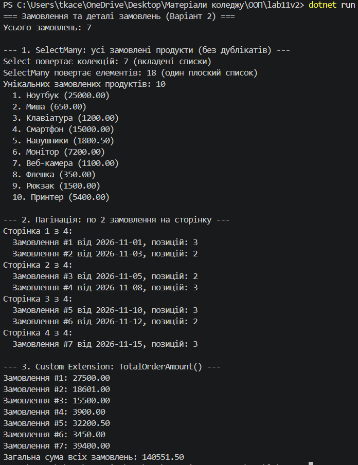

# Звіт з лабораторної роботи №11

**З дисципліни:** Об'єктно-орієнтоване програмування
**Тема:** LINQ: `SelectMany`, пагінація та custom extensions
**Виконав:** студент Ткаченко Максим **Варіант:** №2

## 1. Мета роботи

Навчитися використовувати оператор `SelectMany` для роботи з вкладеними колекціями, реалізовувати пагінацію даних за допомогою LINQ (`Skip`, `Take`), а також створювати власні методи розширення для `IEnumerable<T>`.

## 2. Індивідуальне завдання (Варіант 2)

**Сценарій:** Замовлення та деталі замовлень з продуктами.

**Сутності:**

- `Order` (`Id`, `OrderDate`, `List<OrderDetail>`)
- `OrderDetail` (`Id`, `ProductId`, `Quantity`)
- `Product` (`Id`, `Name`, `Price`)

**Запити:**

1. **SelectMany:** отримати всі продукти, які були замовлені, в одному списку (без дублікатів).
2. **Пагінація:** вивести всі замовлення по 2 замовлення на сторінку.
3. **Custom Extension:** метод розширення `TotalOrderAmount()` для `IEnumerable<OrderDetail>`, що обчислює загальну суму замовлення.

## 3. Структура проєкту

- `lab11v2/Models.cs`: класи сутностей `Product`, `OrderDetail`, `Order`. `Order` містить вкладену колекцію `Details`. Для обчислення суми `OrderDetail` додатково зберігає посилання на `Product` (поруч із `ProductId`).
- `lab11v2/SampleData.cs`: тестові дані: 11 продуктів, 7 замовлень, 18 деталей замовлень. Продукт «Роутер» ніде не замовлений, тому в результат запиту 1 не потрапляє.
- `lab11v2/OrderExtensions.cs`: власний метод розширення `TotalOrderAmount()`.
- `lab11v2/Program.cs`: точка входу `Main`, у якій послідовно демонструються всі три запити.
- `.gitignore`: конфігураційний файл для виключення системних та тимчасових файлів .NET.

## 4. Реалізація

**Запит 1: `SelectMany`** розгортає вкладені списки `Details` в один плоский список, після чого вибираються продукти без дублікатів:

```csharp
var flat = orders.SelectMany(o => o.Details);
var products = flat.Select(d => d.Product).Distinct().ToList();
```

**Запит 2: пагінація** пропускає попередні сторінки (`Skip`) і бере потрібну кількість елементів (`Take`):

```csharp
private static IEnumerable<T> GetPage<T>(IEnumerable<T> source, int pageNumber, int pageSize)
{
    return source.Skip((pageNumber - 1) * pageSize).Take(pageSize);
}
```

**Запит 3: власний метод розширення** працює з будь-якою послідовністю деталей замовлення:

```csharp
public static decimal TotalOrderAmount(this IEnumerable<OrderDetail> details)
{
    ArgumentNullException.ThrowIfNull(details);
    return details.Sum(d => d.Quantity * d.Product.Price);
}
```

Приклад використання:

```csharp
decimal one = order.Details.TotalOrderAmount();                         // сума одного замовлення
decimal all = orders.SelectMany(o => o.Details).TotalOrderAmount();     // сума всіх замовлень
```

## 5. Результати виконання програми

Після запуску програми командою `dotnet run` у терміналі отримано такий вивід:

```text
=== Замовлення та деталі замовлень (Варіант 2) ===
Усього замовлень: 7

--- 1. SelectMany: усі замовлені продукти (без дублікатів) ---
Select повертає колекцій: 7 (вкладені списки)
SelectMany повертає елементів: 18 (один плоский список)
Унікальних замовлених продуктів: 10
  1. Ноутбук (25000.00)
  2. Миша (650.00)
  3. Клавіатура (1200.00)
  4. Смартфон (15000.00)
  5. Навушники (1800.50)
  6. Монітор (7200.00)
  7. Веб-камера (1100.00)
  8. Флешка (350.00)
  9. Рюкзак (1500.00)
  10. Принтер (5400.00)

--- 2. Пагінація: по 2 замовлення на сторінку ---
Сторінка 1 з 4:
  Замовлення #1 від 2026-11-01, позицій: 3
  Замовлення #2 від 2026-11-03, позицій: 2
Сторінка 2 з 4:
  Замовлення #3 від 2026-11-05, позицій: 2
  Замовлення #4 від 2026-11-08, позицій: 3
Сторінка 3 з 4:
  Замовлення #5 від 2026-11-10, позицій: 3
  Замовлення #6 від 2026-11-12, позицій: 2
Сторінка 4 з 4:
  Замовлення #7 від 2026-11-15, позицій: 3

--- 3. Custom Extension: TotalOrderAmount() ---
Замовлення #1: 27500.00
Замовлення #2: 18601.00
Замовлення #3: 15500.00
Замовлення #4: 3900.00
Замовлення #5: 32200.50
Замовлення #6: 3450.00
Замовлення #7: 39400.00
Загальна сума всіх замовлень: 140551.50
```

### Скріншот виконання програми



## 6. Висновок

Під час роботи я використав `SelectMany`, щоб перетворити сім вкладених списків деталей замовлень на один список із 18 елементів і отримати з нього унікальні продукти. На відміну від `Select`, який повертає колекцію колекцій, `SelectMany` одразу дає плоский результат. Пагінація на основі `Skip` і `Take` дозволила вивести сім замовлень чотирма сторінками по два (на останній сторінці одне замовлення). Власний метод розширення `TotalOrderAmount()` інкапсулює бізнес-логіку підрахунку суми, читається як звичайний метод колекції й працює як для одного замовлення, так і для результату `SelectMany`. Усі три підходи добре комбінуються в одному ланцюжку LINQ і роблять код коротшим і зрозумілішим за вкладені цикли.

## 7. Відповіді на контрольні питання

1. **Для чого використовується оператор `SelectMany`? Наведіть приклад, що демонструє його відмінність від `Select`.**
   `SelectMany` проєктує кожен елемент у колекцію й об'єднує ці колекції в одну плоску послідовність. `Select` повертає по одному результату на елемент. Приклад: `orders.Select(o => o.Details)` повертає 7 списків (колекцію колекцій), а `orders.SelectMany(o => o.Details)` повертає 18 окремих деталей замовлень.
2. **Як реалізувати пагінацію даних за допомогою LINQ? Які методи для цього використовуються?**
   Використовують `Skip((pageNumber - 1) * pageSize)`, щоб пропустити попередні сторінки, і `Take(pageSize)`, щоб узяти елементи поточної сторінки. Кількість сторінок обчислюють як `Math.Ceiling(count / (double)pageSize)`. Для стабільного порядку перед пагінацією зазвичай додають `OrderBy`.
3. **Поясніть концепцію методів розширення. Як вони інтегруються у LINQ?**
   Метод розширення це статичний метод у статичному класі, перший параметр якого позначений ключовим словом `this`. Він додає нову поведінку наявному типу без зміни його коду й викликається як звичайний метод екземпляра. Самі оператори LINQ (`Where`, `Select`, `SelectMany`, `Skip`, `Take`) реалізовані як методи розширення для `IEnumerable<T>`, тому власні методи розширення вбудовуються в ті самі ланцюжки викликів.
4. **Наведіть приклад власного методу розширення для `IEnumerable<T>` та поясніть його призначення.**
   `TotalOrderAmount(this IEnumerable<OrderDetail> details)` повертає суму `Quantity * Product.Price` за всіма деталями. Він виносить логіку підрахунку суми в одне місце, а використання виглядає як `order.Details.TotalOrderAmount()`.

## Джерела

- [LINQ (Microsoft Learn)](https://learn.microsoft.com/dotnet/csharp/linq/)
- [Методи розширення (Microsoft Learn)](https://learn.microsoft.com/dotnet/csharp/programming-guide/classes-and-structs/extension-methods)
